<p align="center">
  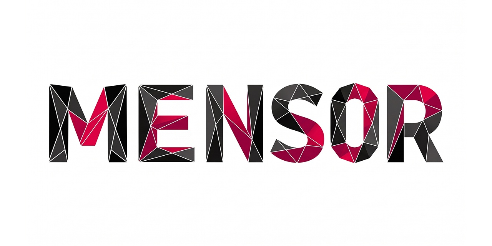
</p>

<div align="center">

# MENSOR

### Privacy-First Offline Hub for Notes, Schedule & Project Management

[](https://opensource.org/licenses/Apache-2.0)
[](https://github.com/MarkusMarrei/mensor/releases/tag/v5.0.0)
[](https://developer.android.com/)
[](https://vuejs.org/)
[](https://capacitorjs.com/)
[](https://www.typescriptlang.org/)
[](https://tailwindcss.com/)
[-success.svg)](#security--architecture)

<p align="center">
  <a href="https://github.com/MarkusMarrei/mensor/releases/download/v5.0.0/Mensor-v5.0.apk">
    
  </a>
</p>

<p align="center">
  <a href="#-download-apk">Direct Download</a> •
  <a href="#-key-highlights">Highlights</a> •
  <a href="#-visual-showcase">Showcase</a> •
  <a href="#-core-features">Features</a> •
  <a href="#-architecture--tech-stack">Architecture</a> •
  <a href="#-quick-start">Quick Start</a> •
  <a href="#-authorship--license">License</a>
</p>

</div>

---

<p align="center">
  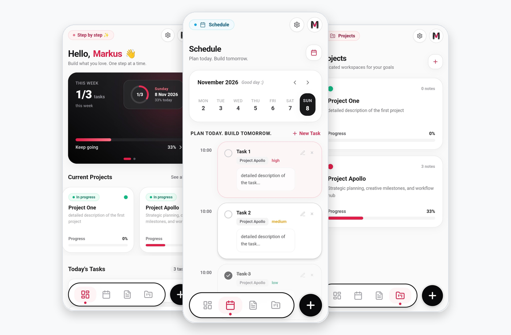
</p>

## 📥 Download APK

You can install and use Mensor right away without cloning or compiling the repository:

| Asset | Platform | Version | Size | Download |
|---|---|---|---|---|
| **Mensor-v5.0.apk** | Android 9.0+ (ARM64 / x86_64) | `v5.0.0` (Latest) | ~5.03 MB | [⬇️ **Download APK**](https://github.com/MarkusMarrei/mensor/releases/download/v5.0.0/Mensor-v5.0.apk) |

> [!TIP]
> **How to install on Android:**  
> 1. Tap **[Download APK](https://github.com/MarkusMarrei/mensor/releases/download/v5.0.0/Mensor-v5.0.apk)** directly on your device.  
> 2. Open the downloaded file from your notifications or `Downloads` folder.  
> 3. If prompted, allow *“Install unknown apps”* in your system settings.  
> 4. All set! Your notes, schedule, and projects remain 100% offline and encrypted.

All official release artifacts are hosted under [GitHub Releases](https://github.com/MarkusMarrei/mensor/releases).

---

## 🌟 Key Highlights

**MENSOR** is a high-performance, offline-first personal workspace designed for thinkers, builders, and professionals. It unifies rich note-taking, timeline task scheduling, and isolated project environments into an elegant, gesture-driven mobile interface — completely fortified by hardware-backed biometrics and client-side AES-256 encryption.

- 🛡️ **100% Offline & Private**: Zero mandatory cloud accounts, zero analytics, zero external tracking. All data is persisted locally in an embedded IndexedDB database powered by Dexie.js.
- 🔐 **Biometric & PIN Lock Shield**: Instant device locking with hardware-backed Fingerprint (Android BiometricPrompt) and custom numeric PIN code.
- 🗂️ **Isolated Project Workspaces**: Dedicated workspaces grouping milestones, tasks, notes, and progress metrics with custom color branding.
- 📅 **Timeline Task Scheduling**: Interactive 7-day horizontal calendar strip with time slots, priority flags (Low, Medium, High), and one-tap task editing.
- 🗣️ **Voice & Text-to-Speech (TTS)**: Built-in speech synthesis to listen to your notes hands-free, plus voice dictation support.
- 📱 **Multi-Device Responsiveness**: Fluid adaptive layout optimized for handheld smartphones and widescreen tablets with edge-to-edge system bar integration.
- 🌍 **Internationalization (9 Languages)**: Fully localized in English, Russian, Spanish, German, French, Portuguese, Italian, Japanese, and Korean.

---

## 📸 Visual Showcase

### Security & Privacy Center
Your thoughts and data are guarded by biometric hardware authentication and client-side encryption.

<p align="center">
  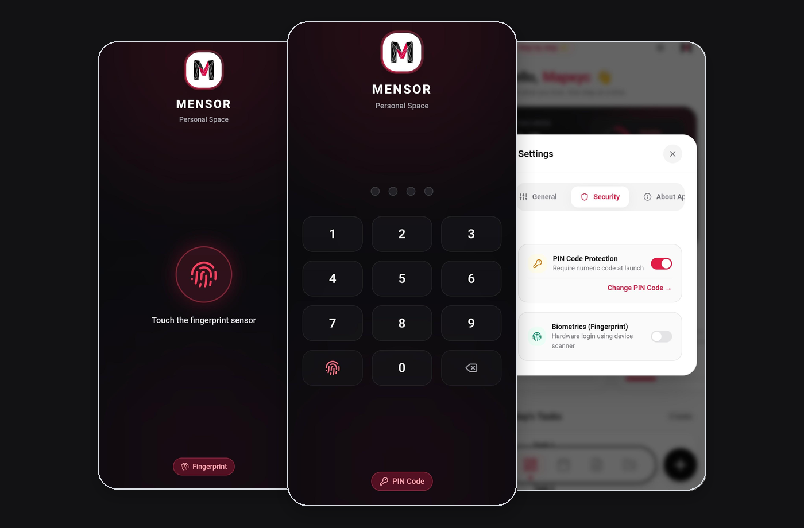
</p>

<table align="center" width="100%">
  <tr>
    <td align="center" width="33%">
      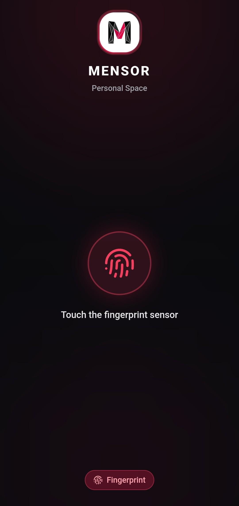<br/>
      <b>Biometric Lock Screen</b><br/>
      <sub>Hardware-backed fingerprint verification</sub>
    </td>
    <td align="center" width="33%">
      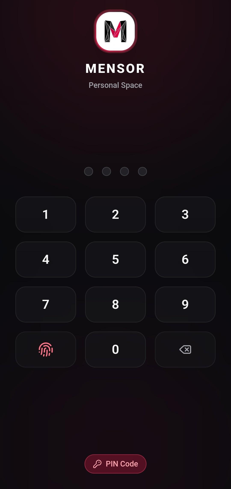<br/>
      <b>Custom PIN Pad</b><br/>
      <sub>Fast 4-digit fallback numeric authentication</sub>
    </td>
    <td align="center" width="33%">
      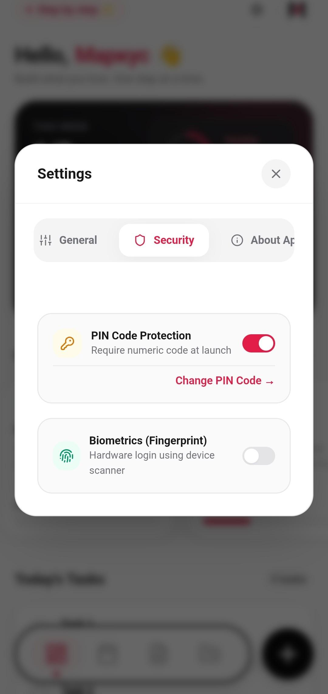<br/>
      <b>Security Controls</b><br/>
      <sub>Toggle PIN protection & biometric sensors</sub>
    </td>
  </tr>
</table>

---

### Project Workspaces & Milestone Tracking
Create focused workspaces for your active initiatives with integrated progress analytics, milestone tasks, and dedicated project notes.

<p align="center">
  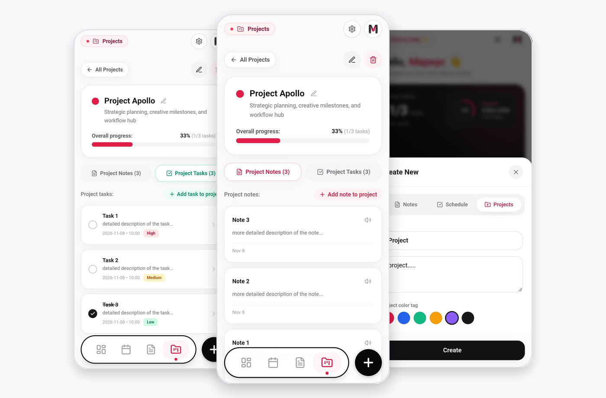
</p>

<table align="center" width="100%">
  <tr>
    <td align="center" width="33%">
      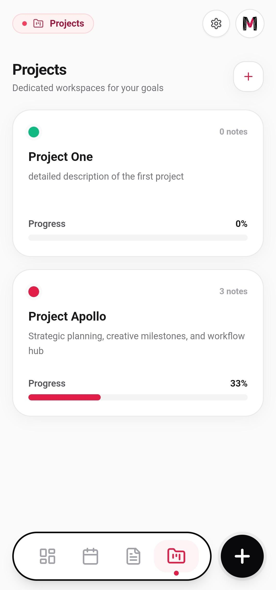<br/>
      <b>Projects Directory</b><br/>
      <sub>Workspace cards with progress indicators</sub>
    </td>
    <td align="center" width="33%">
      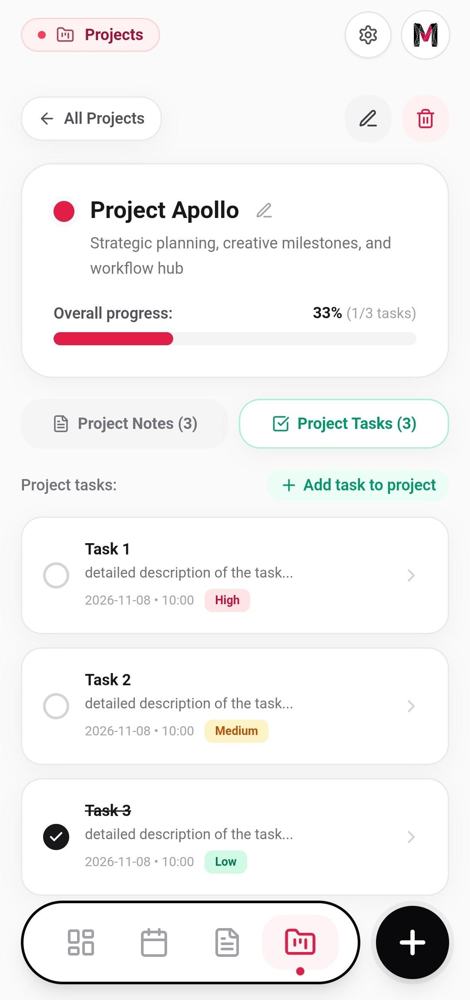<br/>
      <b>Project Tasks Tab</b><br/>
      <sub>Milestones with priority and time slots</sub>
    </td>
    <td align="center" width="33%">
      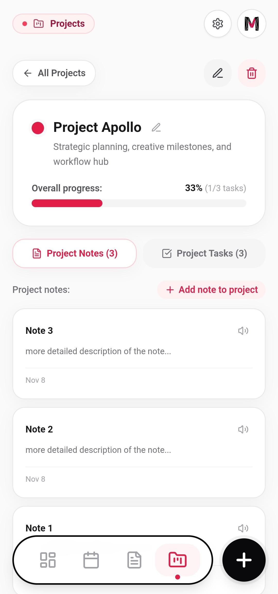<br/>
      <b>Project Notes Tab</b><br/>
      <sub>Dedicated notes with voice readout (TTS)</sub>
    </td>
  </tr>
</table>

---

### Adaptive Tablet & Multi-Device Experience
Whether you are on a compact smartphone or a high-resolution widescreen tablet, Mensor dynamically refines padding, typography, and modal layouts.

<p align="center">
  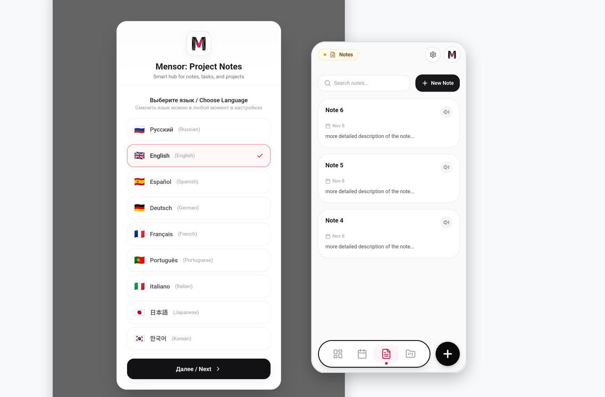
</p>

---

## ⚡ Core Features

### 1. Daily Dashboard & Productivity Analytics
- **Motivational Hero Banner**: Dynamic greeting tailored to the time of day and motivational slogans.
- **Weekly Progress Ring & Bar**: Visual completion percentage and tasks overview for the current week.
- **Year-in-Review Velocity Chart**: Monthly productivity breakdown tracking completed tasks throughout the year.
- **Quick Today's Checklist**: Direct access to today's schedule with interactive status toggles and full task editing.

### 2. Schedule & Timeline Calendar
- **Horizontal 7-Day Calendar Strip**: Seamless day-by-day navigation with current day highlight.
- **Time-Slot Scheduling**: Organize tasks across specific hours (e.g. 09:00, 10:00, 14:00).
- **Clear Priority Signals**:
  - <span style="color:#10B981; font-weight:bold;">● Low Priority</span> (Emerald Green)
  - <span style="color:#F59E0B; font-weight:bold;">● Medium Priority</span> (Amber Yellow)
  - <span style="color:#E11D48; font-weight:bold;">● High Priority</span> (Crimson Red)
- **Modal Task Editor**: Modify titles, descriptions, due dates, time slots, project affiliations, and priorities on the fly.

### 3. Rich Note-Taking & Text-to-Speech
- **Instant Search**: Fast full-text querying across all local notes.
- **Audio Readout (TTS)**: Built-in Text-to-Speech playback for listening to lengthy notes while on the move.
- **Project-Linked or Standalone**: Assign notes to specific project workspaces or keep them in the general notebook.
- **Clean Note Editor**: Distraction-free editing modal with voice input button, character count, and deletion safeguards.

### 4. Smart Creation & Context Navigation
- **Floating Action Button (+)**: Context-aware modal allowing quick creation of Tasks, Notes, or Projects without leaving your current view.
- **Segmented Settings Switcher**: Fluid, horizontally scrollable tabs (*General*, *Security*, *About*) with instant switching and auto-centering.

---

## 🛠️ Architecture & Tech Stack

```
Mensor/
├── android/                         # Native Android container (Capacitor 7)
│   ├── app/src/main/res/            # Adaptive icons, splash screens, drawables
│   └── app/build.gradle             # Android build configuration (v5.0.0, SDK 34)
├── docs/images/                     # Presentation showcases, banners, screenshots
├── public/                          # Static branding assets (Mensor.jpg, icons)
├── src/
│   ├── components/
│   │   ├── layout/                  # TopHeader, BottomNavigation
│   │   ├── modals/                  # Onboarding, LockScreen, Settings, NewItem, EditTask
│   │   └── views/                   # DashboardView, ScheduleView, NotesView, ProjectsView
│   ├── crypto/                      # Client-side AES-256-GCM encryption & PBKDF2 key derivation
│   ├── db/                          # Dexie.js IndexedDB local database & schema migrations
│   ├── i18n/                        # 9 fully translated language dictionaries
│   ├── stores/                      # Pinia reactive stores (app, notes, tasks, projects)
│   ├── types/                       # TypeScript interfaces and data models
│   ├── utils/                       # Text-to-Speech (TTS) engine & helpers
│   ├── App.vue                      # Root shell & seed management
│   └── main.ts                      # Application bootstrap
├── capacitor.config.ts              # Capacitor runtime configuration
├── package.json                     # Project dependencies & scripts
├── vite.config.ts                   # Vite bundler configuration
└── build_apk.bat                    # One-click Windows APK compilation script
```

### Technology Highlights
| Component | Technology | Purpose |
|---|---|---|
| **UI Framework** | [Vue 3 (Composition API)](https://vuejs.org/) | High-performance reactive rendering with `<script setup>` |
| **Styling** | [Tailwind CSS 3.4](https://tailwindcss.com/) | Modern utility-first responsive styling and typography |
| **State Management** | [Pinia 2.3](https://pinia.vuejs.org/) | Modular and fully typed store architecture |
| **Local Storage** | [Dexie.js 4.0](https://dexie.org/) | Robust offline IndexedDB database with indexed queries |
| **Mobile Runtime** | [Capacitor 7.0](https://capacitorjs.com/) | Native Android bridge, biometric hardware integration, TTS |
| **Icons** | [Lucide Vue Next](https://lucide.dev/) | Clean, consistent, and lightweight vector iconography |
| **Encryption** | Web Crypto API (SubtleCrypto) | Client-side AES-256-GCM authenticated cipher |

---

## 🚀 Quick Start

### Prerequisites
- **Node.js**: `20.x` or higher
- **npm**: `10.x` or higher

### Local Development Setup
```bash
# 1. Clone the repository
git clone https://github.com/MarkusMarrei/mensor.git
cd mensor

# 2. Install dependencies
npm install

# 3. Launch local Vite development server
npm run dev
```

Visit `http://localhost:5173` in your browser.

---

## 📦 Building Android APK

### Prerequisites for Native Android Build
- **JDK**: Java Development Kit 17 (e.g. `C:\src\jdk-17` or OpenJDK 17)
- **Android SDK**: API Level 34 (`Android SDK Platform 34`, `Build-Tools 34.0.0`)
- **Android Studio / Command Line Tools**

### Automated One-Click Build (Windows)
Run the automated build script from the repository root:
```bat
build_apk.bat
```

### Manual Command-Line Build
```bash
# 1. Build the production web bundle
npm run build

# 2. Sync web assets to the native Android container
npx cap sync android

# 3. Compile the Android APK via Gradle
cd android
./gradlew assembleDebug      # macOS / Linux
.\gradlew.bat assembleDebug  # Windows
```

The resulting debug APK will be generated at:
```
android/app/build/outputs/apk/debug/app-debug.apk
```

---

## 🔒 Security & Privacy Policy

- **No Remote Telemetry**: Mensor contains no remote telemetry, crash reporters, or external tracking SDKs.
- **Cryptographic Storage**: Sensitive archives and exports are encrypted using AES-256-GCM with PBKDF2 (100,000 iterations) key derivation.
- **Biometric Enclave**: Biometric authentication executes strictly through the Android operating system's `BiometricPrompt` and hardware-backed keystore; biometric keys never leave the device.

---

## 📄 Authorship & License

**Creator & Lead Developer:**
- **Markus Marrei** (*Маркус Маррей*)
- GitHub: [@MarkusMarrei](https://github.com/MarkusMarrei/mensor)
- Repository: [https://github.com/MarkusMarrei/mensor](https://github.com/MarkusMarrei/mensor)

Distributed under the **Apache License 2.0**.

```text
Copyright 2026 Markus Marrei (Маркус Маррей)

Licensed under the Apache License, Version 2.0 (the "License");
you may not use this file except in compliance with the License.
You may obtain a copy of the License at

    http://www.apache.org/licenses/LICENSE-2.0

Unless required by applicable law or agreed to in writing, software
distributed under the License is distributed on an "AS IS" BASIS,
WITHOUT WARRANTIES OR CONDITIONS OF ANY KIND, either express or implied.
See the License for the specific language governing permissions and
limitations under the License.
```
